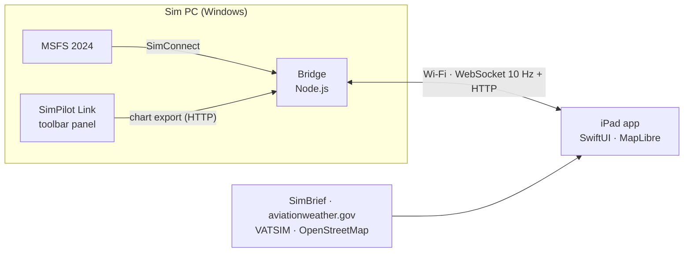

<div align="center">


# SimPilot EFB

**An airline-style electronic flight bag for Microsoft Flight Simulator 2024, built for the iPad.**

[](https://github.com/footfungus2/simpilot-efb/actions/workflows/build-ipa.yml)
[](https://github.com/footfungus2/simpilot-efb/releases/latest)


[**Download**](https://github.com/footfungus2/simpilot-efb/releases/latest) · [Features](#features) · [Screenshots](#screenshots) · [Install](#install-on-the-ipad) · [Connect to MSFS](#connect-to-msfs-2024)

</div>

---

SimPilot EFB recreates the look and workflow of a modern airline EFB (inspired by Lido mPilot) for home cockpit use. It runs
natively on the iPad, talks to MSFS 2024 over your local Wi-Fi, and stays useful even when the sim PC is off: SimBrief,
weather, VATSIM and the maps all load directly on the iPad.

> [!NOTE]
> Unofficial hobby project, not affiliated with or endorsed by Lufthansa Systems, Lido, Microsoft, Asobo, SimBrief or
> VATSIM. It uses none of their names or logos in the app. Charts come from your own MSFS 2024 installation and are
> for personal use only. Don't redistribute them.

## Contents

- [Features](#features)
- [Screenshots](#screenshots)
- [Install on the iPad](#install-on-the-ipad)
- [Connect to MSFS 2024](#connect-to-msfs-2024)
- [How it works](#how-it-works)
- [Building from source](#building-from-source)
- [Project status](#project-status)
- [Data sources & credits](#data-sources--credits)

## Features

### Enroute map
- **3D globe** that flattens into a flat chart as you zoom in, with a clean solid-colour basemap
- SimBrief route with waypoint triangles, FIR boundaries and airports
- **NAV filters**: route, airports, FIRs, VOR, NDB, DME/TACAN and frequency labels
- **Tap anything for details**: route fixes show the planned level, leg and remaining distance and the ETA; navaids show frequency, channel and variation; airports show the live METAR
- **Vertical profile** and **flight progress strip** (next fix, top of descent, destination)
- Weather: METAR station dots and SIGMET areas

### Airport moving map
- Zoom into any airport for a ground map with taxiways, runways, **stands and holding points**, without roads or clutter
- Taxi-route highlighting and an **ON RWY / APPROACHING RWY** awareness banner
- Data from OpenStreetMap, cached on the device so it works offline afterwards

### Charts
- The sim's built-in charts, exported by an in-sim toolbar panel
- **Your aircraft drawn on georeferenced charts**, with follow mode
- **Show a chart on the map**, overlaid in place
- **Apple Pencil annotations** (double-tap honours the system eraser and palette setting), plus split view of chart and map
- **Flight chart pack**: pin the charts for this flight and keep them available offline

### Flight folder
- Loads your latest **SimBrief** OFP: route, navlog, fuel, alternates and the full OFP document
- Route notes, extra alternates and a demo flight mode for testing without the sim

### Fenix A320 cockpit panels
- An **Aircraft** tab with the Fenix A320's controls in a clean EFB layout, live in both directions:
  - **Radios**: RMP 1 and 2 with active/standby windows, transfer, VHF/HF/NAV keys and the dual frequency knob
  - **ATC / TCAS**: squawk keypad, IDENT, transponder mode, ALT RPTG, TCAS mode and traffic selector
  - **Autopilot (FCU)**: speed, heading, altitude and V/S targets with push/pull, AP1/AP2, A/THR, LOC, APPR, EXPED
  - **Lights and signs**: exterior lights, seat belts, no smoking, emergency exit, dome and annunciator lights
- Runs through the PC bridge (SimConnect L:vars), using the community HubHop presets for the Fenix

### VATSIM assistant
- Enter your callsign and see what ATC has given your flight: the **assigned squawk** (one tap sets it in the Fenix),
  the cruise level and route in your flight plan, and a log of **amendments made by controllers**
- **Who to call**: the approach/centre covering your position and the stations at your departure and arrival
- Uses only your callsign's entry in the public VATSIM data feed (spoken instructions aren't published by VATSIM)

### VATSIM layer
- Live pilots and controllers, styled after VATSIM Radar
- **Real sector ownership** from VATGlasses at the flight level you choose, with approach areas and traffic counts

## Screenshots

<table>
  <tr>
    <td width="50%"><br><b>Enroute map</b><br>SimBrief route, FIRs, airports and the flight folder</td>
    <td width="50%"><br><b>Airport moving map</b><br>Stands, holding points, taxiway names and runway badges</td>
  </tr>
  <tr>
    <td><br><b>Live VATSIM</b><br>Online controllers, real sector ownership and approach areas</td>
    <td><br><b>Tap for details</b><br>Planned level, leg and distance for any fix on the route</td>
  </tr>
  <tr>
    <td><br><b>Charts</b><br>Airport, approach and departure charts by category</td>
    <td><br><b>Split view</b><br>Chart and live map side by side</td>
  </tr>
</table>

## Install on the iPad

**Requirements:** an iPad on iPadOS 15 or later with [TrollStore](https://github.com/opa334/TrollStore) installed.

1. On the iPad, open the **[latest release](https://github.com/footfungus2/simpilot-efb/releases/latest)**.
2. Download **`SimPilotEFB.ipa`**.
3. Open it with **TrollStore** and tap *Install*.

Updates install the same way, over the old version, and keep your settings. Every push to `main` is built automatically by
GitHub Actions and published as a new release.

On first launch, open **Settings** and enter your SimBrief username, then tap **Load latest OFP**.

## Connect to MSFS 2024

The iPad and the sim PC must be on the **same Wi-Fi network**.

**1. Start the bridge on the sim PC**

1. Install [Node.js 20+](https://nodejs.org) (LTS).
2. Download this repository ([ZIP](https://github.com/footfungus2/simpilot-efb/archive/refs/heads/main.zip)) and unzip it.
3. Start MSFS 2024, then double-click **`bridge/start-bridge.bat`**. If Windows Firewall asks, allow **private networks**.
4. The window shows the PC's address, for example `192.168.1.20:8380`.

The app finds the bridge automatically. If it doesn't, enter that address under **Settings → Bridge**. This alone gives you
the live aircraft position on the map, the vertical profile and the charts.

**2. Optional: enable chart export from the sim**

1. In MSFS 2024, enable *Developer Mode*, then **Help → SDK Installer** and install the SDK.
2. In PowerShell, inside the `sim-package` folder, run
   `powershell -ExecutionPolicy Bypass -File .\build.ps1`. This builds the panel and copies it into your Community folder.
   If it picks the wrong folder, add yours: `... -File .\build.ps1 -Community "D:\MSFS\Community"`.
3. Start a **Free Flight**, open the toolbar's **gear icon** and switch **SimPilot Link** on (MSFS 2024 hides add-on panels
   until you do), then open it. It shows *Bridge: connected* and exports charts when the iPad asks for them.

## How it works



| Folder | Contents |
|---|---|
| [`ios/`](ios) | The iPad app: SwiftUI, iOS 15 target, XcodeGen project, MapLibre Native |
| [`bridge/`](bridge) | Node.js + TypeScript server on the sim PC: aircraft position at 10 Hz, chart cache, Bonjour discovery |
| [`sim-package/`](sim-package) | MSFS 2024 toolbar panel that exports the sim's charts to the bridge |
| [`shared/protocol.md`](shared/protocol.md) | Protocol between bridge, app and panel |
| [`scripts/`](scripts) | IPA build, Wi-Fi install page, map library and basemap data tools |
| [`docs/`](docs) | UI design reference |

## Building from source

<details>
<summary><b>iPad app (macOS + Xcode)</b></summary>

```sh
brew install xcodegen
./scripts/build-ipa.sh          # downloads MapLibre if needed, builds an unsigned SimPilotEFB.ipa
```

- Open in Xcode: `cd ios && xcodegen && open SimPilotEFB.xcodeproj`
- To run on **My Mac (Designed for iPad)**, create `ios/Local.xcconfig` containing `DEVELOPMENT_TEAM = <your team ID>`.
  This file is not committed.
- MapLibre is vendored by `scripts/vendor-maplibre.sh`. It uses the globe build, with its declared minimum lowered to iOS 15.0.
</details>

<details>
<summary><b>Fast updates over Wi-Fi during development</b></summary>

Recent Xcode versions can't deploy to iOS 15 devices, so development builds go through TrollStore's install link:

```sh
./scripts/dev-install.sh        # build and serve an install page on port 8090
./scripts/dev-install.sh stop   # stop the page
```

Open the printed `http://<mac-ip>:8090` on the iPad and tap **Install update in TrollStore**. The *URL Scheme Enabled*
option must be on in TrollStore's settings.
</details>

<details>
<summary><b>Bridge and sim panel</b></summary>

```sh
cd bridge && npm install && npm test && npm run dev
cd sim-package && npm install && npm run build
```

To run the bridge on another machine, enable remote SimConnect on the sim PC (`SimConnect.xml`, address `0.0.0.0`,
port 5111) and start the bridge with `SIMPILOT_SIMCONNECT=<pc-ip>:5111`.
</details>

<details>
<summary><b>Basemap data</b></summary>

The bundled map layers (land, airports, navaids, FIRs, VATSIM sectors) are rebuilt with:

```sh
python3 -I scripts/build-basemap.py
```
</details>

## Project status

Early development (`0.1.x`). It works today without the sim (SimBrief, maps, weather, VATSIM, demo flight).

- [ ] First end-to-end test of the bridge and chart export in MSFS 2024
- [ ] Confirm the globe build of MapLibre on iPadOS 15.3
- [ ] Airways, enroute intersections from sim navigation data, grid MORA

Issues and pull requests are welcome.

## Data sources & credits

| Data | Source | License |
|---|---|---|
| Coastlines, lakes, country labels | [Natural Earth](https://www.naturalearthdata.com) | Public domain |
| Airports and navaids | [OurAirports](https://ourairports.com) | Public domain |
| FIR/UIR boundaries | [VATSpy Data Project](https://github.com/vatsimnetwork/vatspy-data-project) | CC BY-SA 4.0 |
| Approach areas | [SimAware TRACON Project](https://github.com/vatsimnetwork/simaware-tracon-project) | CC BY-SA 4.0 |
| Sector ownership | [VATGlasses Data Project](https://github.com/lennycolton/vatglasses-data) | CC BY-NC-SA 4.0, non-commercial |
| Airport moving maps | © [OpenStreetMap](https://www.openstreetmap.org/copyright) contributors, fetched at runtime | ODbL |
| Live traffic | [VATSIM](https://vatsim.net) data feed | |
| Weather | [aviationweather.gov](https://aviationweather.gov) | |
| Map rendering | [MapLibre Native](https://github.com/maplibre/maplibre-native) | BSD-2-Clause |
| Fenix A320 control presets | [HubHop](https://hubhop.mobiflight.com) community presets (MobiFlight) | |

**Debug charts:** UK AIP charts are © NATS / Crown copyright, so the PDFs are not included. Only their georeferencing is in
[`manifest.json`](ios/SimPilotEFB/Resources/TestCharts/manifest.json). To use them, download the EGSS SIDs *CLN 5S/9R* and
*DET 2D* from the UK AIP and save them under the file names listed there. Without them, the app simply skips those charts.
