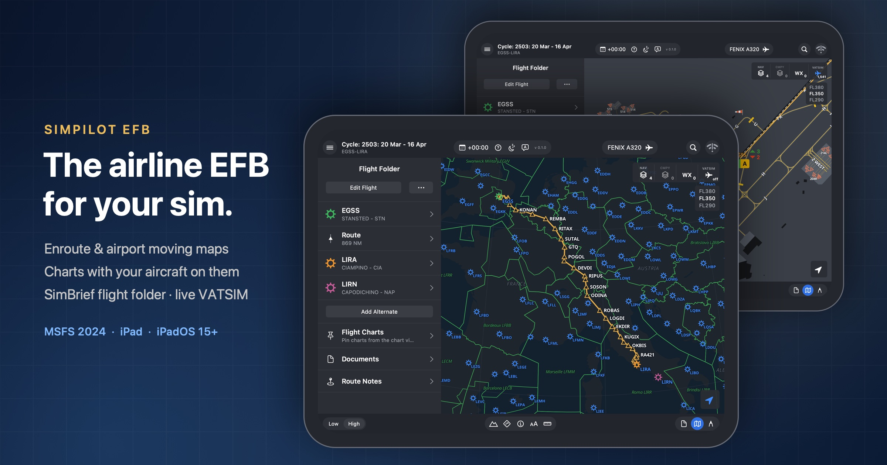
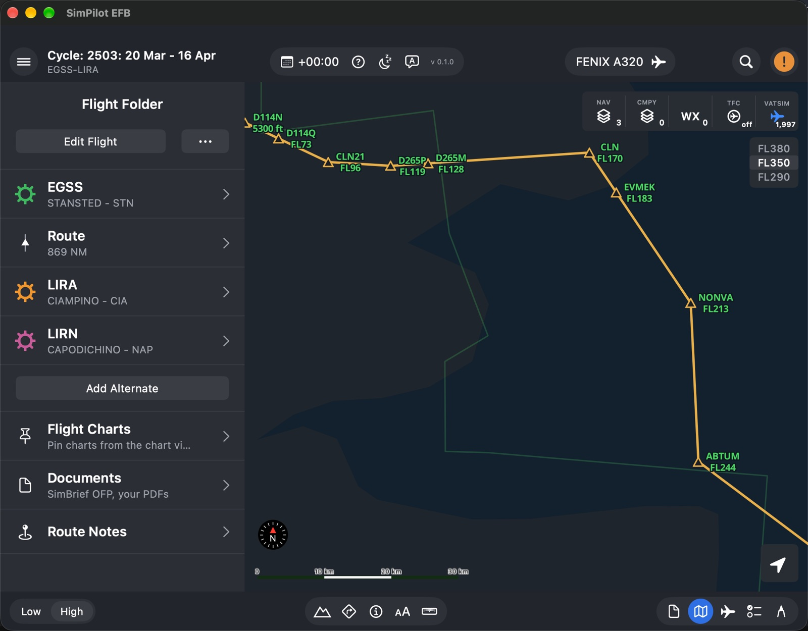
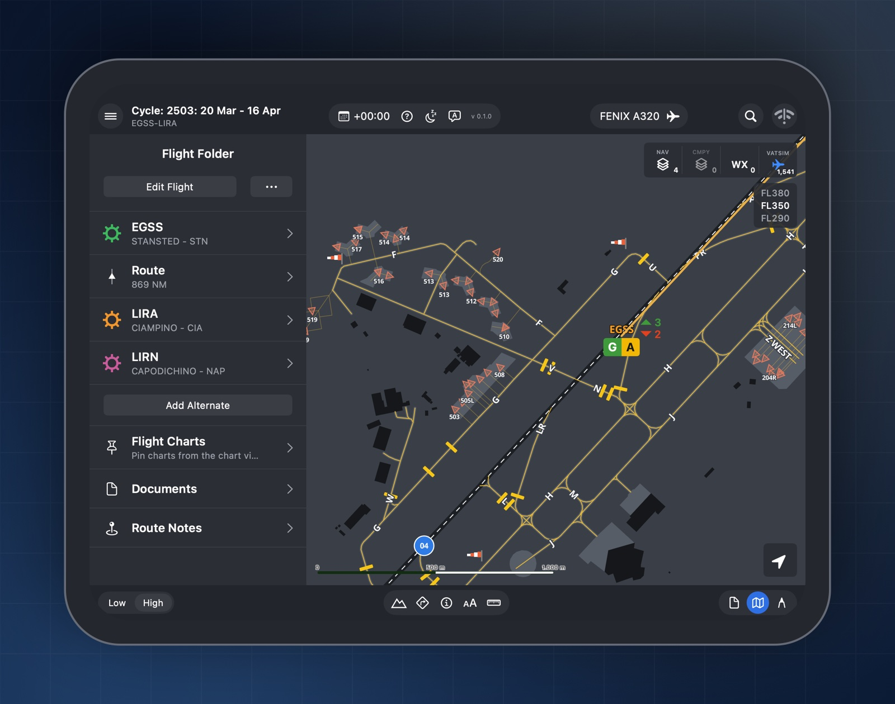
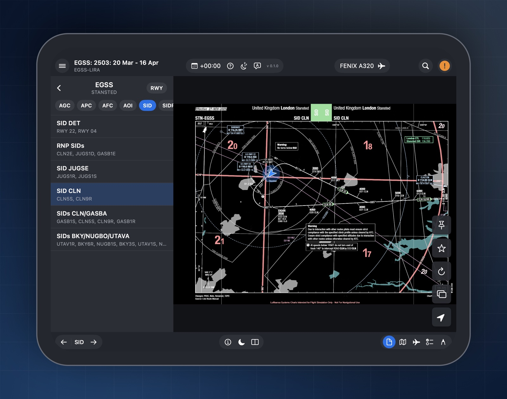
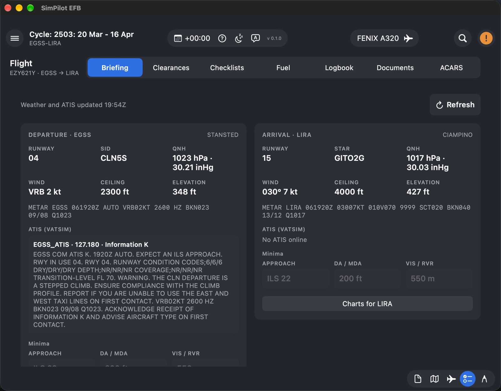
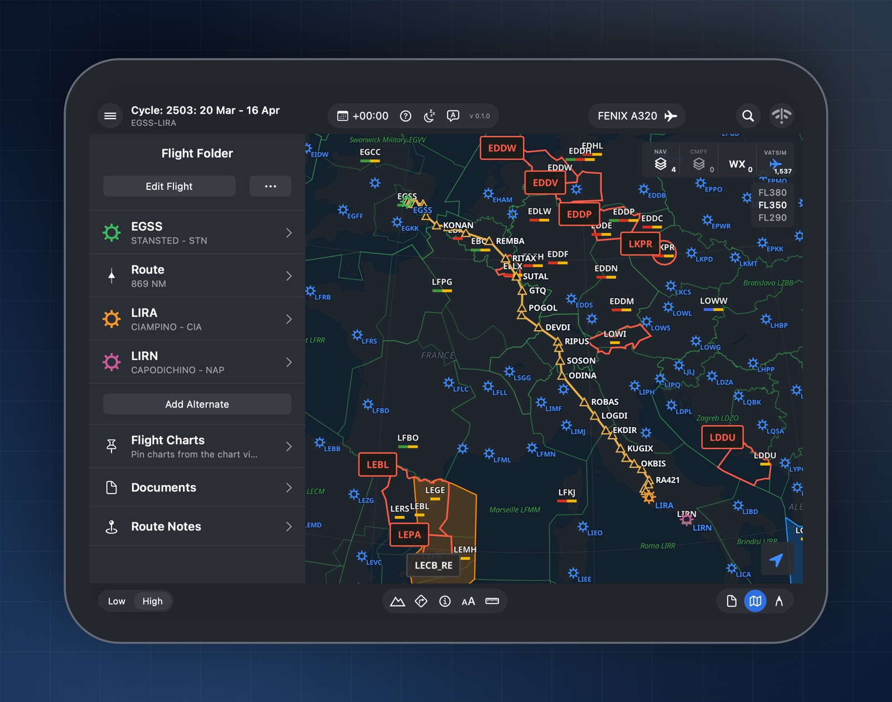
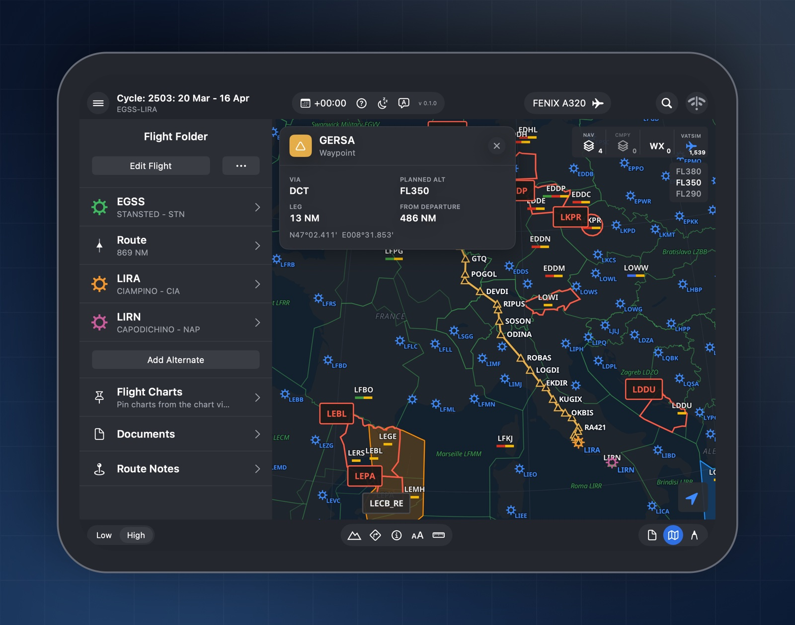
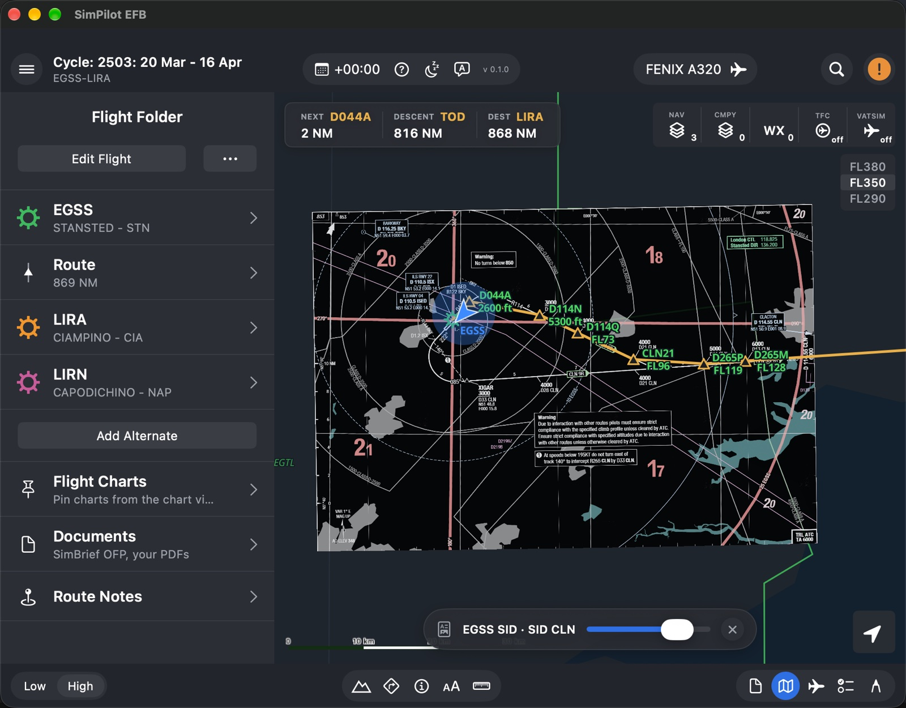
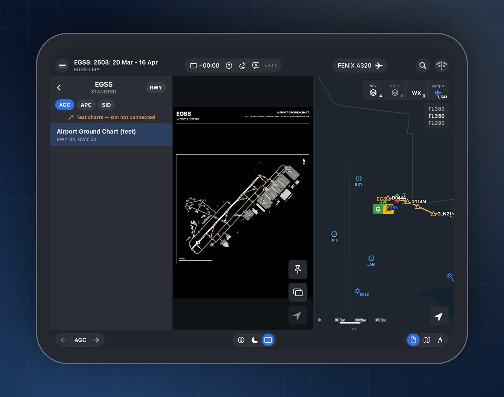
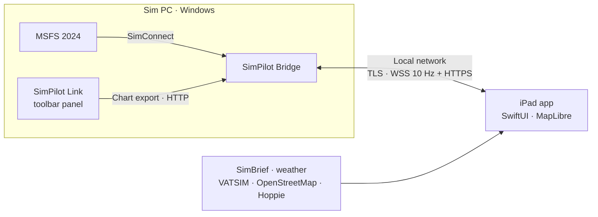

<div align="center">

# SimPilot EFB

**An airline-style flight bag for Microsoft Flight Simulator 2024. Built for iPad.**

[](https://github.com/footfungus2/simpilot-efb/actions/workflows/build-ipa.yml)
[](https://github.com/footfungus2/simpilot-efb/releases/latest)

[](LICENSE)

[**Download the latest release**](https://github.com/footfungus2/simpilot-efb/releases/latest) · [Get started](#get-started) · [What's new](docs/updates)



[Features](#features) · [Screenshots](#screenshots) · [Connect to MSFS](#connect-to-msfs-2024) · [Troubleshooting](#troubleshooting) · [Build from source](#building-from-source)

</div>

SimPilot EFB brings a SimBrief flight folder, moving maps, charts, weather and VATSIM into a native SwiftUI app.
Its layout is inspired by Lido mPilot. Plan and brief on the iPad, then connect to your sim PC for live aircraft
position, chart exports and Fenix A320 controls.

> [!NOTE]
> **Release candidate (0.1.x).** Automated build, test and packaging checks run before publication. Physical iPad,
> MSFS chart export and Fenix checks are still tracked in [release validation](docs/release-validation.md).

## Features

| | What you can do |
| :--- | :--- |
| **Enroute map** | Follow your SimBrief route on a 3D globe that becomes a flat map as you zoom in. See planned waypoint altitudes, T/C and T/D, route airways, FIRs and navaids, with a vertical profile and flight progress strip. |
| **Airport moving map** | See runways, taxiways, stands and named holding points. Enter a taxi route, choose your stand and hold point, and follow the route as completed sections turn grey. Runway-awareness banners show when you approach or enter a runway. |
| **Charts** | View the sim's built-in charts, put your aircraft on georeferenced pages, overlay a chart on the map, or open chart and map side by side. Add Pencil annotations, star favourites and pin a flight pack for offline use. |
| **Flight folder & tools** | Import your SimBrief OFP, navlog, fuel and alternates. Edit the runway and SID/STAR in use, brief the flight, record clearances, tick checklists, compare fuel, keep a logbook and annotate your own PDFs. |
| **Weather** | METAR and TAF with plain-language decoding, VATSIM ATIS, SIGMETs, precipitation radar and TAF-based map indicators up to 12 hours ahead. |
| **VATSIM & ACARS** | Live pilots, controllers and VATGlasses sectors; company traffic; an assistant showing your filed route, assigned squawk and nearby ATC; Hoppie PDC, telex, weather requests and CPDLC replies. |
| **Fenix A320** | Radio panels, ATC/TCAS, FCU targets and push/pull actions, exterior lights and cabin signs, connected through the PC bridge. |
| **Customization** | Day, Night or Match iPad appearance, accent and route colours, map text size, UTC clock, dark charts, opening screen and motion settings that respect Reduce Motion. |

<details>
<summary><b>Map controls and data coverage</b></summary>

- **NAV** filters the route, airports, FIRs, VORs, NDBs, DME/TACAN and frequency labels. Waypoint altitude labels are coloured by climb, cruise and descent and can be switched off.
- **Low / High** changes level choices and map detail. **AA** changes text size; the ruler measures distance, true/magnetic bearing and time, with snapping and a live aircraft start point.
- Tap route fixes for planned level, leg distance and ETA; navaids for frequency, channel and variation; airports for weather.
- **WX** includes METAR indicators, SIGMET details and RainViewer radar with two hours of history. Radar is real-world weather and matches the sim only when using live weather; its free tiles stop at zoom 7.
- **TFC** shows AI and multiplayer aircraft from the sim. **CMPY** highlights your airline's VATSIM traffic independently of the main VATSIM layer.
- **Grid MORA** uses terrain data for Europe, the Mediterranean, North Africa, the Middle East and the North Atlantic. It does not include obstacles and is never for real navigation.
- Airways are labelled along your imported route. Airways and enroute intersections beyond that route, plus icing and turbulence forecasts, are not included.
- Airport maps come from OpenStreetMap and are cached after loading. Taxi routes follow connected taxiway paths; when a path cannot be connected, the named taxiways are highlighted instead.

</details>

<details>
<summary><b>Inside the Flight screen</b></summary>

Open **Flight** using the checklist icon in the bottom bar.

- **Briefing:** departure, destination and alternates with runway, SID/STAR, live QNH, wind, METAR, available VATSIM ATIS, entered minima and chart shortcuts.
- **Clearances:** altitude, heading, speed, squawk and next frequency, with timestamped history and a Pencil scratchpad saved per flight.
- **Checklists:** editable A320 normal checklists with progress saved per flight.
- **Fuel:** reported fuel on board against the SimBrief plan, including waypoint checks. Requires the bridge and an aircraft that reports total fuel.
- **Logbook:** automatic takeoff/landing logging while connected to the sim, with editable block times and notes.
- **Documents:** import PDFs up to 100 MB from Files, bookmark pages, resume reading, use night mode and add Pencil notes.
- **ACARS:** use your own [Hoppie logon code](https://www.hoppie.nl/acars/), stored in the iPad's Keychain. CPDLC follows community client conventions; live ATC validation is still outstanding.

The VATSIM assistant reads your callsign's public feed entry. It cannot retrieve spoken ATC instructions.

</details>

## Screenshots

<table>
  <tr>
    <td width="50%" align="center">
      <a href="docs/images/enroute-map.jpg"></a>
      <br><b>Enroute map</b><br>Route, waypoint altitudes and flight progress
    </td>
    <td width="50%" align="center">
      <a href="docs/images/airport-map.jpg"></a>
      <br><b>Airport moving map</b><br>Stands, taxiways and named holding points
    </td>
  </tr>
  <tr>
    <td align="center">
      <a href="docs/images/charts.jpg"></a>
      <br><b>Charts</b><br>Chart browsing, annotations and aircraft position
    </td>
    <td align="center">
      <a href="docs/images/flight-briefing.jpg"></a>
      <br><b>Flight briefing</b><br>Departure, arrival and live weather in one place
    </td>
  </tr>
</table>

<details>
<summary><b>More screenshots: VATSIM, route details and chart layouts</b></summary>

<table>
  <tr>
    <td width="50%" align="center">
      <a href="docs/images/vatsim.jpg"></a>
      <br><b>Live VATSIM</b><br>Controllers, sectors and approach areas
    </td>
    <td width="50%" align="center">
      <a href="docs/images/waypoint-details.jpg"></a>
      <br><b>Waypoint details</b><br>Planned level, leg distance and ETA
    </td>
  </tr>
  <tr>
    <td align="center">
      <a href="docs/images/chart-on-map.jpg"></a>
      <br><b>Chart on the map</b><br>Georeferenced overlay with adjustable opacity
    </td>
    <td align="center">
      <a href="docs/images/split-view.jpg"></a>
      <br><b>Split view</b><br>Chart and map with independent zoom
    </td>
  </tr>
</table>

</details>

Some screenshots show development test charts. These are not bundled with release builds.

## Get started

### Install on the iPad

You need an **iPad on iPadOS 15 or later** and a compatible [TrollStore](https://github.com/opa334/TrollStore)
or [SideStore](https://sidestore.io) setup. Installer support depends on your iPadOS version.

1. Open the **[latest release](https://github.com/footfungus2/simpilot-efb/releases/latest)** on your iPad and download **`SimPilotEFB.ipa`**.
2. Install it with **TrollStore**, or import it into **SideStore** to sign and install. Set up your chosen installer first; SideStore has an [installation guide](https://docs.sidestore.io/docs/installation/install).
3. Open SimPilot EFB. The first-launch walkthrough covers the main screens and connections; you can skip it.
4. In **Settings**, enter your SimBrief username or pilot ID and tap **Load latest OFP**.

### What needs a connection?

| Setup | Available features |
| :--- | :--- |
| **iPad with internet** | SimBrief, weather, VATSIM, Hoppie ACARS and airport-map downloads. These services connect directly from the iPad. |
| **iPad + PC bridge** | Live aircraft position, sim traffic, aircraft fuel data, automatic takeoff/landing logging and Fenix controls. |
| **PC bridge + SimPilot Link panel** | Exporting the sim's chart list and images. |
| **Saved on the iPad** | Pinned flight charts, previously cached airport maps, imported PDFs, clearances and checklist progress. |

For offline charts, pin them to **★ FLIGHT** while connected and wait for the save to finish. Failed or incomplete
saves show an error. Opening a chart once does not guarantee it will remain available offline.

### Updates

**iPad:** use the optional update banner or **Settings → Updates**. Choose **Update** to open TrollStore or SideStore,
or **Later** to keep flying. If detection is wrong or unavailable, choose **Settings → Updates → Update with**.
Keep the same installer and signing identity to retain app data. Version and build numbers are checked, so updates
within the same app version are detected too.

**PC:** click **Install update** when it appears in SimPilot Bridge. The bridge downloads the update and restarts.
Keep the PC bridge and SimPilot Link panel from the same PC download.

## Connect to MSFS 2024

Put the iPad and Windows sim PC on the **same local network**. Ethernet on the PC is fine.

### 1. Start the PC bridge

1. On the sim PC, download **`SimPilot-for-PC.zip`** from the [latest release](https://github.com/footfungus2/simpilot-efb/releases/latest).
2. Right-click → **Extract All**, then open the **SimPilot for PC** folder.
3. Run **SimPilot Bridge.exe** and leave it running while you fly. Closing its window leaves it in the system tray.
   If the app will not open, use **SimPilot Bridge (console).cmd**.
4. Allow **Private networks** if Windows Firewall asks. It may identify the bridge as **Node.js JavaScript Runtime**.
5. In the bridge window or console, find the PC address and pairing code. Enter both in **SimPilot → Settings → Bridge** on the iPad.
   The code contains a pairing key and the PC certificate fingerprint, separated by a colon. It stays in the iPad's Keychain.

No separate Node.js installation is needed for the PC download. Start the bridge before or after MSFS.
The iPad bridge connection uses TLS and pins the certificate from the pairing code. Keep the code private and use a trusted local network.
The in-sim panel uses loopback HTTP on port **8386**; the iPad connects over HTTPS and WebSocket Secure on port **8387**.
After updating an older bridge, replace the saved pairing code with the new key-and-fingerprint code from the PC.
Allow SimPilot EFB to use the iPad's local network when prompted. The top-right connection icon is **orange !** when the bridge is found but
MSFS or the chart panel is missing, and **green ✓** when both are connected. Orange is expected if you do not use the chart panel.

### 2. Add the chart panel (optional)

The **SimPilot Link** toolbar panel exports the charts from your own MSFS 2024 installation.

1. In MSFS, enable **Settings → Advanced Options → Developer Mode**. In the developer menu, choose
   **Help → SDK Installer** and install the SDK. Developer Mode can then be switched off.
2. **Close MSFS.** In **SimPilot Bridge → Charts**, click **Install chart panel** and follow the checks.
   Alternatively, run **Chart panel (optional) → Install SimPilot Link.bat** from the extracted PC folder.
   If asked for a location, select the MSFS **Packages** folder.
3. Restart MSFS. In a flight, open the toolbar's **gear icon**, enable **SimPilot Link**, then open the panel.
   A healthy connection shows **Bridge: connected**. Open the panel once per flight.
4. Run MSFS in **windowed or borderless mode**. Keep the panel open, fully visible and uncovered during export.

The panel displays each chart page so the bridge can capture it from the screen. A larger or popped-out panel gives
sharper captures. Chart lists load first; pages export when requested, with the loaded flight's SID, STAR and runway
approaches prepared in the background. Charts you open yourself take priority.

Charts are for personal simulator use. Do not redistribute exported images.

## Troubleshooting

<details>
<summary><b>The iPad cannot find the bridge</b></summary>

- Use the same local network; avoid guest networks and isolated Wi-Fi clients.
- Set your home connection to **Private** in Windows **Settings → Network & internet**.
- In the bridge's **Repair** page, use **Fix firewall**. You can also allow **Node.js JavaScript Runtime** on private networks in Windows Security.
- On iPad, check **Settings → Privacy → Local Network → SimPilot EFB**.
- Enter the PC address and pairing code shown in the bridge window under **Settings → Bridge**. Choose the Wi-Fi or Ethernet address rather than a VPN or virtual adapter.
- In the console version, selecting text can pause the bridge. Press **Esc** to resume.

</details>

<details>
<summary><b>SimPilot Link stays on “searching” or charts will not export</b></summary>

- Confirm MSFS is windowed or borderless and the panel is visible, uncovered and not minimised.
- Check the panel's **Startup**, **Panel build**, **Bridge build** and **Last request** rows. Keep the startup or error text when reporting a problem.
- Close MSFS and run **Repair SimPilot Link.bat** from **Chart panel (optional)** in the matching PC download. It verifies and replaces the installed HTML, CSS and script, keeping a backup without another SDK build.
- **Diagnose SimPilot Link.bat** creates a local report of package paths, asset hashes, the bridge listener, status and bounded logs. Review it before sharing. A matching installed file does not prove MSFS loaded that copy.
- Restart MSFS after installation or repair, then open SimPilot Link again.

</details>

<details>
<summary><b>Collect a diagnostic report</b></summary>

Open **Settings → Help → Diagnostics / debug console** in the iPad app. It shows bridge, simulator and chart-link
status, aircraft-data age and recent errors.

Reproduce the problem, then tap **Copy diagnostic report** for the current status and last 300 app events.
**Load PC bridge logs** adds up to 200 events from the connected PC. Logs stay in memory for the session and are
not uploaded automatically. URLs, credentials and account paths are redacted; review reports before sharing.

</details>

## How it works



| Folder | Contents |
| :--- | :--- |
| [`ios/`](ios) | SwiftUI iPad app, MapLibre Native and XCTest sources |
| [`bridge/`](bridge) | Node.js/TypeScript bridge, Windows launcher, chart cache and Bonjour discovery |
| [`sim-package/`](sim-package) | MSFS toolbar panel and install/repair tools |
| [`shared/protocol.md`](shared/protocol.md) | App, bridge and panel protocol |
| [`scripts/`](scripts) | Build, packaging, development install and map-data tools |
| [`docs/`](docs) | Design reference, update notes, screenshots and release validation |

## Building from source

Run these commands from the repository root unless noted otherwise.

<details>
<summary><b>iPad app · macOS and full Xcode</b></summary>

Install Xcode and XcodeGen, then build an unsigned IPA:

```sh
brew install xcodegen
./scripts/build-ipa.sh
```

The script downloads the pinned MapLibre build if needed, builds the app and validates **`SimPilotEFB.ipa`** in the
repository root. Install it with TrollStore or sign it with SideStore.

To open the project in Xcode:

```sh
cd ios
xcodegen
open SimPilotEFB.xcodeproj
```

For **My Mac (Designed for iPad)**, put `DEVELOPMENT_TEAM = <your team ID>` in `ios/Local.xcconfig`; it is ignored by Git.
MapLibre uses a vendored globe pre-release with its deployment declaration lowered to iOS 15.0. Device compatibility
still needs the checks listed in [release validation](docs/release-validation.md).

</details>

<details>
<summary><b>Development installs</b></summary>

Build the IPA and copy it into `ios/build/dist` for transfer to the iPad:

```sh
./scripts/dev-install.sh
# Stop an install page server left by an older checkout:
./scripts/dev-install.sh stop
```

Use AirDrop to send the IPA, then open it with TrollStore or import it into SideStore. The former one-tap HTTP page is disabled because an unencrypted transfer could install a substituted IPA.

</details>

<details>
<summary><b>PC bridge and MSFS panel</b></summary>

Use **Node.js 22.x, version 22.12 or later**, to match CI and the locked test tools.
The packaged PC download includes its runtime and does not need Node installed separately.

Install, test and start the bridge:

```sh
npm --prefix bridge ci
npm --prefix bridge test
npm --prefix bridge run dev
```

The development server stays running. In a separate terminal at the repository root, build the panel:

```sh
npm --prefix sim-package ci
npm --prefix sim-package run build
```

- On Windows, `bridge/start-bridge.bat` is another way to start the bridge from source.
- `npm --prefix bridge run package:portable` on Windows bundles the bridge beside an unmodified official Node.js runtime and checks startup. CI separately verifies the runtime's signature. `scripts/package-pc.ps1` stages `SimPilot-for-PC.zip` with the chart panel.
- `sim-package/install.bat` builds and installs the panel into `Community2024`; this requires Node.js and the MSFS 2024 SDK. From `sim-package/`, use `.\build.ps1 -Community "D:\MSFS\Packages\Community2024"` to choose the folder.
- `sim-package/repair.bat` updates an existing panel without the SDK (`.\build.ps1 -UpdateScript`). Close MSFS first. It keeps a backup; a first installation still needs the SDK.

For aircraft data and development with the bridge on another machine, enable remote SimConnect on the sim PC using
`SimConnect.xml`, address `0.0.0.0` and port `5111`, then start the bridge with `SIMPILOT_SIMCONNECT=<pc-ip>:5111`.
Chart screen capture still requires the bridge to run on the sim PC.

</details>

<details>
<summary><b>Rebuild basemap data</b></summary>

Rebuild the bundled land, airport, navaid, FIR and VATSIM sector layers:

```sh
python3 -I scripts/build-basemap.py
```

</details>

## Project status

SimPilot EFB is a hobby project and release candidate. Build and packaging checks do not establish physical-device
or live-simulator compatibility. The [validation checklist](docs/release-validation.md) tracks the remaining checks:

- [ ] Map/globe rendering and performance on iPadOS 15.3.1
- [ ] End-to-end Windows bridge, SimPilot Link chart capture and reconnection in MSFS 2024
- [ ] Fenix control/readback, fuel data and automatic flight logging in the simulator
- [ ] Pinned charts, annotations and saved flight data after an offline app restart
- [ ] Installer updates and retained data on physical devices; live Hoppie/CPDLC exchanges

Issues and pull requests are welcome. Include the app/bridge versions and a reviewed diagnostic report when reporting a connection problem.

This project is not affiliated with or endorsed by Lufthansa Systems, Lido, Microsoft, Asobo, SimBrief or VATSIM.
It is for flight simulation only.

## License

The original SimPilot EFB source code is licensed under the [zlib License](LICENSE),
copyright (c) 2026 footfungus2. You may use, modify and redistribute it, including commercially,
provided you do not misrepresent the original authorship, clearly mark altered source versions
and preserve the notice in source distributions.

Third-party dependencies, libraries and data retain their own licenses and terms, including
the sources listed below. The zlib License does not override those terms.

## Data sources & credits

| Data | Source | License |
|---|---|---|
| Coastlines, lakes, country labels | [Natural Earth](https://www.naturalearthdata.com) | Public domain |
| Airports and navaids | [OurAirports](https://ourairports.com) | Public domain |
| FIR/UIR boundaries | [VATSpy Data Project](https://github.com/vatsimnetwork/vatspy-data-project) | CC BY-SA 4.0 |
| Approach areas | [SimAware TRACON Project](https://github.com/vatsimnetwork/simaware-tracon-project) | CC BY-SA 4.0 |
| Sector ownership | [VATGlasses Data Project](https://github.com/lennycolton/vatglasses-data) | CC BY-NC-SA 4.0, non-commercial |
| Airport moving maps | © [OpenStreetMap](https://www.openstreetmap.org/copyright) contributors, fetched at runtime | ODbL |
| Live traffic | [VATSIM](https://vatsim.net) data feed | |
| Weather | [aviationweather.gov](https://aviationweather.gov) | |
| Radar | [RainViewer](https://www.rainviewer.com) public radar frames | Personal use |
| Grid MORA terrain | [AWS Terrain Tiles](https://registry.opendata.aws/terrain-tiles/) (built into `mora.geojson` by `scripts/build-mora.py`) | Open data, see the registry page for the sources |
| ACARS | [Hoppie's ACARS](https://www.hoppie.nl/acars/) | Your own logon code |
| Map rendering | [MapLibre Native](https://github.com/maplibre/maplibre-native) | BSD-2-Clause |
| Fenix A320 control presets | [HubHop](https://hubhop.mobiflight.com) community presets (MobiFlight) | |

**Debug charts:** UK AIP charts are © NATS / Crown copyright, so the PDFs are not included. Only their georeferencing is in
[`manifest.json`](ios/SimPilotEFB/Resources/TestCharts/manifest.json). To use them, download the EGSS SIDs *CLN 5S/9R* and
*DET 2D* from the UK AIP and save them under the file names listed there. Without them, the app simply skips those charts.
