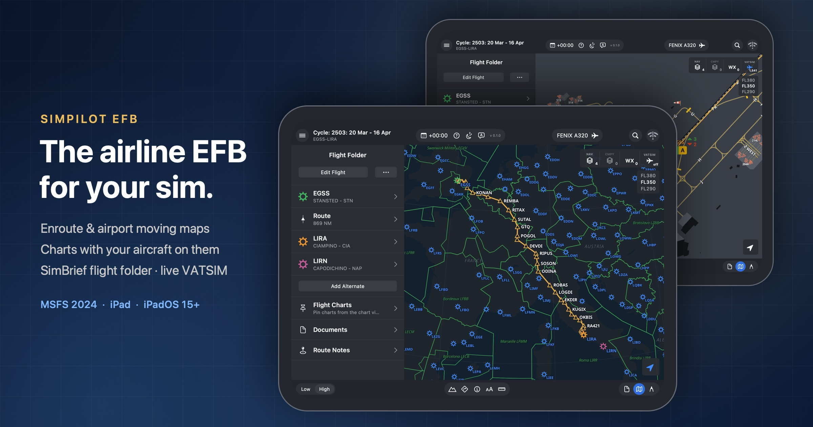
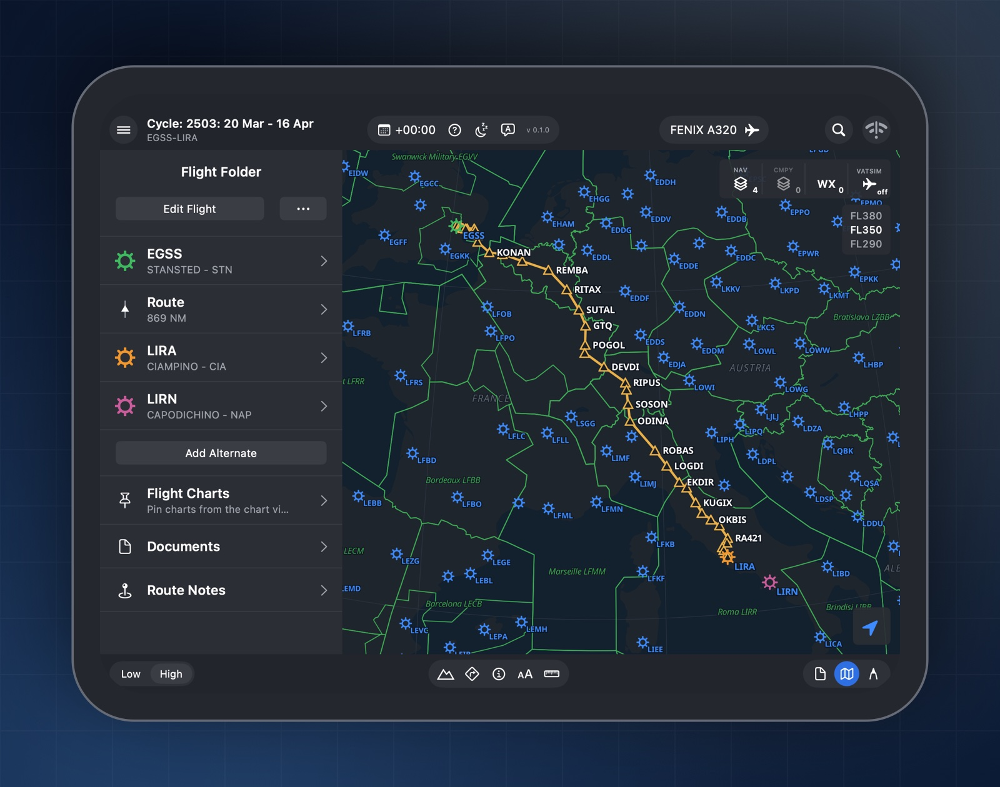
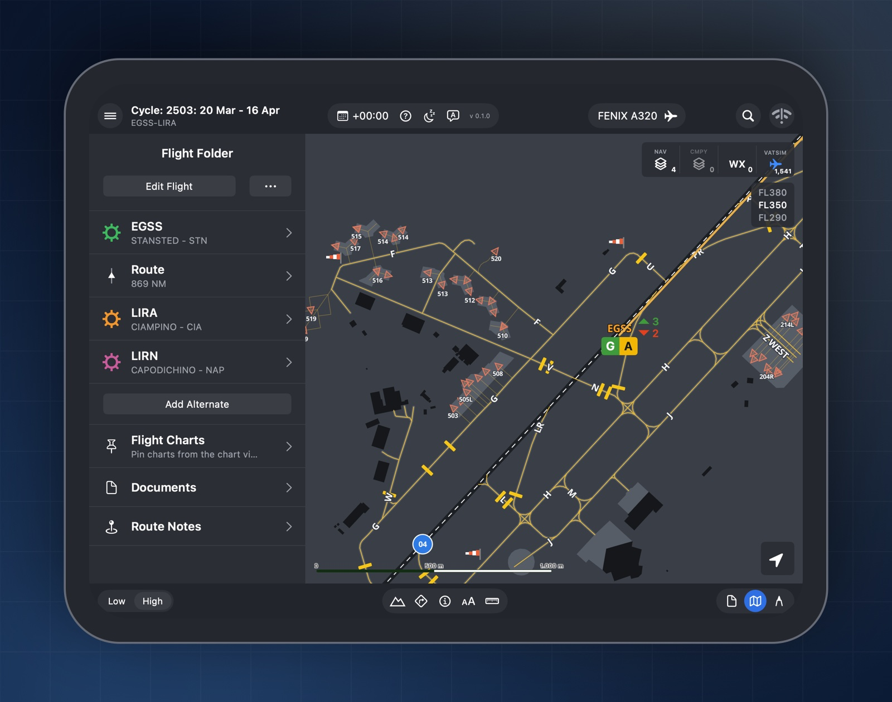
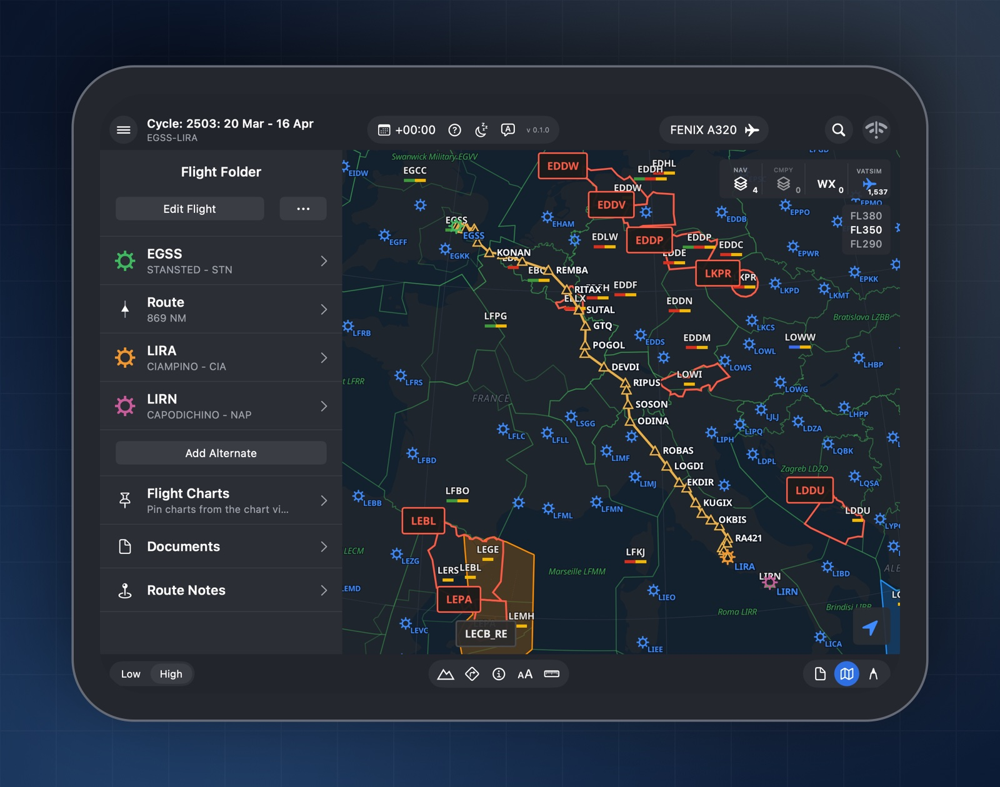
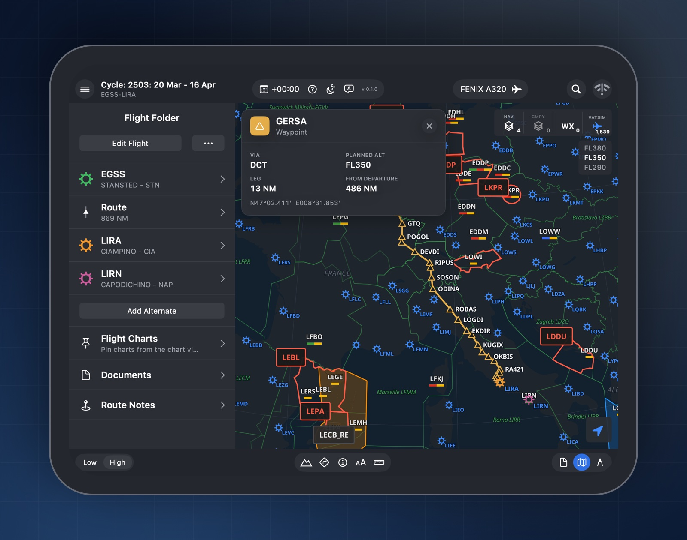
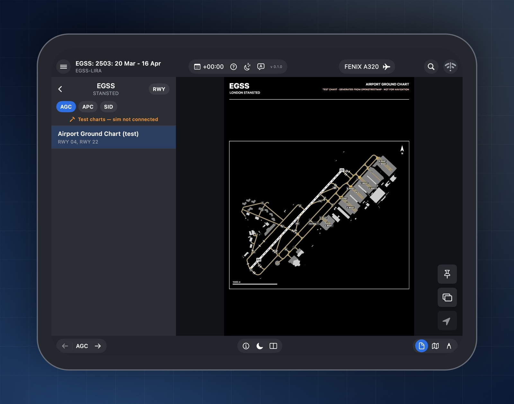
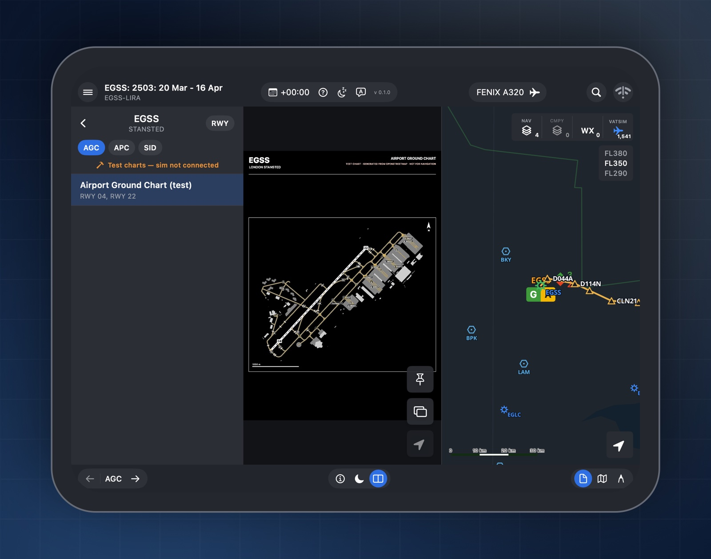
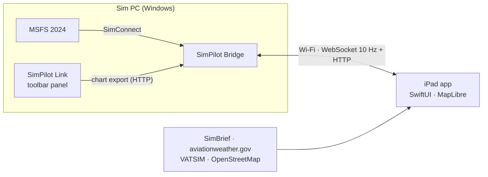

<div align="center">



# SimPilot EFB

**An airline-style electronic flight bag for Microsoft Flight Simulator 2024, built for the iPad.**

[](https://github.com/footfungus2/simpilot-efb/actions/workflows/build-ipa.yml)
[](https://github.com/footfungus2/simpilot-efb/releases/latest)


[**Download**](https://github.com/footfungus2/simpilot-efb/releases/latest) · [Features](#features) · [Screenshots](#screenshots) · [Install](#install-on-the-ipad) · [Connect to MSFS](#connect-to-msfs-2024)

</div>

---

SimPilot EFB recreates the look and workflow of a modern airline EFB (inspired by Lido mPilot) for home cockpit use. It runs
natively on the iPad, talks to MSFS 2024 over your local Wi-Fi, and stays useful even when the sim PC is off: SimBrief,
weather, VATSIM and the maps all load directly on the iPad.

> [!NOTE]
> Unofficial hobby project, not affiliated with or endorsed by Lufthansa Systems, Lido, Microsoft, Asobo, SimBrief or
> VATSIM. It uses none of their names or logos in the app. Charts come from your own MSFS 2024 installation and are
> for personal use only. Don't redistribute them.

## Contents

- [Update log](docs/updates)
- [Features](#features)
- [Screenshots](#screenshots)
- [Install on the iPad](#install-on-the-ipad)
- [Connect to MSFS 2024](#connect-to-msfs-2024)
- [How it works](#how-it-works)
- [Building from source](#building-from-source)
- [Project status](#project-status)
- [Data sources & credits](#data-sources--credits)

## Features

### Enroute map
- **3D globe** that flattens into a flat chart as you zoom in, with a clean solid-colour basemap
- SimBrief route with waypoint triangles, FIR boundaries and airports
- **NAV filters**: route, airports, FIRs, VOR, NDB, DME/TACAN and frequency labels
- **Low / High** switches level choices and map detail; High hides NDBs and small airfields
- **AA** changes map text size; the **ruler** measures distance, true/magnetic bearing and time, with snapping and a live aircraft start point
- **Tap anything for details**: route fixes show the planned level, leg and remaining distance and the ETA; navaids show frequency, channel and variation; airports show the live METAR
- **Vertical profile** and **flight progress strip** (next fix, top of descent, destination)
- **Weather layer**: METAR indicators for 5 000+ stations worldwide (green / amber / red by flight category) and SIGMET areas
  with hazard and level labels. Tap an indicator for the airport's METAR and TAF, raw or in plain language, or a SIGMET for its details
- **Weather time**: the `+00:00` menu in the top bar shows the forecast up to 12 hours ahead (TAF-based indicators, SIGMETs valid at that time)
- **ATIS & weather briefing**: the speech-bubble button in the top bar opens VATSIM ATIS, METAR and TAF for your departure,
  destination, alternates, the nearest airport or any ICAO, with a *Decoded* switch for plain language

### Make it yours
- **Settings → Customization**: Night, Day or *Match iPad* theme, accent colour, animations (Full, Reduced, Off), a UTC clock in the
  top bar, map text size, route colour, 3D globe and grid on or off, dark charts at night, and the screen the app opens on
- Smooth, subtle animations throughout; they follow the iPad's *Reduce Motion* setting

### Airport moving map
- Zoom into any airport for a ground map with taxiways, runways, **stands and holding points**, without roads or clutter
- Taxi-route highlighting and an **ON RWY / APPROACHING RWY** awareness banner
- Data from OpenStreetMap, cached on the device so it works offline afterwards

### Charts
- The sim's built-in Lido charts, exported by an in-sim toolbar panel: the list loads at once, a chart takes a few seconds the first time you open it
- **Your aircraft drawn on georeferenced charts**, with follow mode
- **Show a chart on the map**, overlaid in place
- **Apple Pencil annotations** (double-tap honours the system eraser and palette setting), plus split view of chart and map
- **Flight chart pack**: pin the charts for this flight and keep them available offline

### Flight folder
- Loads your latest **SimBrief** OFP: route, navlog, fuel, alternates and the full OFP document
- Route notes and extra alternates

### Fenix A320 cockpit panels
- An **Aircraft** tab with the Fenix A320's controls in a clean EFB layout, live in both directions:
  - **Radios**: RMP 1 and 2 with active/standby windows, transfer, VHF/HF/NAV keys and the dual frequency knob
  - **ATC / TCAS**: squawk keypad, IDENT, transponder mode, ALT RPTG, TCAS mode and traffic selector
  - **Autopilot (FCU)**: speed, heading, altitude and V/S targets with push/pull, AP1/AP2, A/THR, LOC, APPR, EXPED
  - **Lights and signs**: exterior lights, seat belts, no smoking, emergency exit, dome and annunciator lights
- Runs through the PC bridge (SimConnect L:vars), using the community HubHop presets for the Fenix

### VATSIM assistant
- Enter your callsign and see what ATC has given your flight: the **assigned squawk** (one tap sets it in the Fenix),
  the cruise level and route in your flight plan, and a log of **flight-plan changes**
- **Who to call**: the approach/centre covering your position and the stations at your departure and arrival
- Uses only your callsign's entry in the public VATSIM data feed (spoken instructions aren't published by VATSIM)

### VATSIM layer
- Live pilots and controllers, styled after VATSIM Radar
- **Real sector ownership** from VATGlasses at the flight level you choose, with approach areas and traffic counts
- **CMPY company traffic**: your airline's pilots, highlighted in orange with callsigns; it works independently of the main VATSIM layer

## Screenshots

<table>
  <tr>
    <td width="50%"><br><b>Enroute map</b><br>SimBrief route, FIRs, airports and the flight folder</td>
    <td width="50%"><br><b>Airport moving map</b><br>Stands, holding points, taxiway names and runway badges</td>
  </tr>
  <tr>
    <td><br><b>Live VATSIM</b><br>Online controllers, real sector ownership and approach areas</td>
    <td><br><b>Tap for details</b><br>Planned level, leg and distance for any fix on the route</td>
  </tr>
  <tr>
    <td><br><b>Charts</b><br>Airport, approach and departure charts by category</td>
    <td><br><b>Split view</b><br>Chart and live map side by side</td>
  </tr>
</table>

## Install on the iPad

**Requirements:** an iPad on iPadOS 15 or later with a compatible [TrollStore](https://github.com/opa334/TrollStore) or [SideStore](https://sidestore.io) installation.

1. On the iPad, open the **[latest release](https://github.com/footfungus2/simpilot-efb/releases/latest)**.
2. Download **`SimPilotEFB.ipa`**.
3. Open it with **TrollStore** and tap *Install*, or import the IPA into **SideStore** to sign and install it. SideStore must be set up on the iPad first; see the [official install guide](https://docs.sidestore.io/docs/installation/install).

The app checks for updates on launch. Tap **Update** in the optional banner or **Settings → Updates** to open
the detected installer (TrollStore or SideStore) with the latest IPA. Tap **Later** to dismiss the banner and keep using the installed version.
Detection checks this app's installation markers. If the installer is unknown, choose it in **Settings → Updates → Update with**;
you can also override detection there. Settings has a manual check, release notes and a download link. The installer may ask you to confirm installation.
Keep the same installer and signing identity when updating to retain app data. Every push to `main` is checked by
GitHub Actions; a complete, tested build is published under its own version/build tag. Update metadata comes from
the packaged app, so newer builds within the same app version are detected too.

On first launch, a short walkthrough covers SimBrief, the PC bridge and the main app sections. Tap **Skip** at any time. To load a flight, open **Settings**, enter your SimBrief username or pilot ID, then tap **Load latest OFP**.

### Diagnostics

Open **Settings → Help → Diagnostics / debug console** for bridge, simulator and chart-link status, the age of
aircraft data, and recent app errors. Reproduce a problem, then tap **Copy diagnostic report** to copy the current
status and the last 300 events. **Load PC bridge logs** includes up to 200 events from the connected PC. Logs stay
in memory for the session and are not sent to a reporting service. URLs, credentials and account paths are redacted;
flight plans and account details are not logged. Review copied reports before sharing them.

To use charts without the PC connection, save them to the **★ FLIGHT** pack first. Failed saves show an error instead
of claiming the chart is available offline.

## Connect to MSFS 2024

You only need this for the **live aircraft on the map**, the **sim's charts** and the **Fenix A320 controls**. Everything
else works without the PC. Put the iPad and sim PC on the **same local network**, by Wi-Fi or Ethernet.

### Step 1: run SimPilot Bridge on the PC

1. On the sim PC, open the **[latest release](https://github.com/footfungus2/simpilot-efb/releases/latest)** and download
   **`SimPilot-for-PC.zip`**.
2. Right-click the zip, choose **Extract All**, then open the **SimPilot for PC** folder inside.
3. Double-click **SimPilot Bridge.cmd** (shown as **SimPilot Bridge** if file extensions are hidden) and leave its window open while you fly.
   - If Windows Firewall asks, tick **Private networks** and click **Allow access**. Windows may call this app
     **Node.js JavaScript Runtime**; that is SimPilot Bridge.
4. On the iPad, tap **OK** when SimPilot EFB asks to find devices on your local network.

That's all: there is nothing to install, and it doesn't matter whether you start it before or after MSFS. The app finds
it by itself. The round icon at the top right turns **orange !** when the PC is found, and **green ✓** once MSFS
and the optional chart panel are connected too. An orange icon with no chart panel is expected.

### Step 2 (optional): show the sim's charts on the iPad

A small **SimPilot Link** panel in the MSFS toolbar sends the sim's charts to the iPad. You set it up once:

1. In MSFS 2024, open **Settings → Advanced Options** and switch **Developer Mode** on. In the menu bar that appears at
   the top, choose **Help → SDK Installer** and install the SDK (Microsoft's free add-on kit, which the panel installer
   uses). You can switch Developer Mode off again afterwards.
2. **Close MSFS 2024.** Inside **SimPilot for PC**, open **Chart panel (optional)** and double-click **Install SimPilot Link**
   (shown as **Install SimPilot Link.bat** if file extensions are visible). It finds your
   MSFS folder by itself. If it asks, choose the MSFS **Packages** folder.
3. **Start MSFS 2024 again**; new add-ons load when the sim starts. In a flight, click the **gear icon** in the toolbar, switch **SimPilot Link** on, then open it. It shows
   *Bridge: connected*. Open it once per flight.
4. **Keep the panel open and fully visible** (not minimised or covered). The chart list of an airport appears on the iPad
   at once. A chart is exported from the sim the first time you open it, which takes a few seconds: MSFS doesn't let
   add-ons read its chart images, so the panel shows each page and SimPilot Bridge copies it from the screen. A bigger
   panel, or one popped out into its own window, is faster and gives sharper charts. Each chart is exported once, then
   kept on the PC and the iPad.

### Not connecting?

- Use the same local network, not a guest network. Wired Ethernet on the PC is fine.
- Windows: **Settings → Network & internet → Wi-Fi** (or **Ethernet**) → your home network → **Private network**.
- If you cancelled the firewall prompt: **Windows Security → Firewall & network protection → Allow an app through
  firewall → Change settings**, find **Node.js JavaScript Runtime** and tick **Private**.
- iPad: **Settings → Privacy → Local Network** → switch **SimPilot EFB** on.
- Type the address shown in the SimPilot Bridge window, for example `192.168.1.20:8386`, into the app under
  **Settings → Bridge**.
- Choose the Wi-Fi or Ethernet address rather than a VPN or virtual adapter. If selecting text pauses the bridge
  window, press **Esc** to resume.
- **Settings → Help → Diagnostics** in the app shows which part isn't connected.

## How it works



| Folder | Contents |
|---|---|
| [`ios/`](ios) | The iPad app: SwiftUI, iOS 15 target, XcodeGen project, MapLibre Native |
| [`bridge/`](bridge) | Node.js + TypeScript server on the sim PC: aircraft position at 10 Hz, chart cache, Bonjour discovery |
| [`sim-package/`](sim-package) | MSFS 2024 toolbar panel that exports the sim's charts to the bridge |
| [`shared/protocol.md`](shared/protocol.md) | Protocol between bridge, app and panel |
| [`scripts/`](scripts) | IPA build, Wi-Fi install page, map library and basemap data tools |
| [`docs/`](docs) | UI design reference |

## Building from source

<details>
<summary><b>iPad app (macOS + Xcode)</b></summary>

```sh
brew install xcodegen
./scripts/build-ipa.sh          # downloads MapLibre if needed, builds an unsigned SimPilotEFB.ipa
```

- Open in Xcode: `cd ios && xcodegen && open SimPilotEFB.xcodeproj`
- To run on **My Mac (Designed for iPad)**, create `ios/Local.xcconfig` containing `DEVELOPMENT_TEAM = <your team ID>`.
  This file is not committed.
- MapLibre is vendored by `scripts/vendor-maplibre.sh`. It uses the globe build, with its declared minimum lowered to iOS 15.0.
</details>

<details>
<summary><b>Fast updates over Wi-Fi during development</b></summary>

Recent Xcode versions can't deploy to iOS 15 devices, so development builds go through TrollStore's install link:

```sh
./scripts/dev-install.sh        # build and serve an install page on port 8090
./scripts/dev-install.sh stop   # stop the page
```

Open the printed `http://<mac-ip>:8090` on the iPad and tap **Install update in TrollStore**. The *URL Scheme Enabled*
option must be on in TrollStore's settings.
</details>

<details>
<summary><b>Bridge and sim panel</b></summary>

Running from source needs [Node.js 20+](https://nodejs.org) (the release's `SimPilot-for-PC.zip` doesn't).

```sh
cd bridge && npm install && npm test && npm run dev   # or double-click bridge/start-bridge.bat on Windows
cd sim-package && npm install && npm run build
```

- `npm run package:portable` (in `bridge/`, on Windows with the official Node.js 22+ runtime) bundles the bridge
  beside an unmodified, signature-checked `node.exe` and checks that it starts; `scripts/package-pc.ps1` stages
  `SimPilot-for-PC.zip` with the ready-made chart panel. No separate Node.js installation is needed.
- `sim-package/install.bat` builds the panel from source (Node.js + MSFS 2024 SDK) and installs it into `Community2024`.
  To choose the folder yourself: `build.ps1 -Community "D:\MSFS\Packages\Community2024"`.

To run the bridge on another machine, enable remote SimConnect on the sim PC (`SimConnect.xml`, address `0.0.0.0`,
port 5111) and start the bridge with `SIMPILOT_SIMCONNECT=<pc-ip>:5111`.
</details>

<details>
<summary><b>Basemap data</b></summary>

The bundled map layers (land, airports, navaids, FIRs, VATSIM sectors) are rebuilt with:

```sh
python3 -I scripts/build-basemap.py
```
</details>

## Project status

Release candidate (`0.1.x`). SimBrief, maps, weather and VATSIM work independently of the simulator.
Build/test and packaging checks run before publication; the remaining device checks are tracked in
[release validation](docs/release-validation.md).

- [ ] First end-to-end test of the bridge and chart export in MSFS 2024
- [ ] Confirm the globe build of MapLibre on iPadOS 15.3
- [ ] Verify Fenix controls and installer updates on physical devices

Future features: airways, enroute intersections from sim navigation data, grid MORA.

Issues and pull requests are welcome.

## License

The original SimPilot EFB source code is licensed under the [zlib License](LICENSE),
copyright (c) 2026 footfungus2. You may use, modify and redistribute it, including commercially,
provided you do not misrepresent the original authorship, clearly mark altered source versions
and preserve the notice in source distributions.

Third-party dependencies, libraries and data retain their own licenses and terms, including
the sources listed below. The zlib License does not override those terms.

## Data sources & credits

| Data | Source | License |
|---|---|---|
| Coastlines, lakes, country labels | [Natural Earth](https://www.naturalearthdata.com) | Public domain |
| Airports and navaids | [OurAirports](https://ourairports.com) | Public domain |
| FIR/UIR boundaries | [VATSpy Data Project](https://github.com/vatsimnetwork/vatspy-data-project) | CC BY-SA 4.0 |
| Approach areas | [SimAware TRACON Project](https://github.com/vatsimnetwork/simaware-tracon-project) | CC BY-SA 4.0 |
| Sector ownership | [VATGlasses Data Project](https://github.com/lennycolton/vatglasses-data) | CC BY-NC-SA 4.0, non-commercial |
| Airport moving maps | © [OpenStreetMap](https://www.openstreetmap.org/copyright) contributors, fetched at runtime | ODbL |
| Live traffic | [VATSIM](https://vatsim.net) data feed | |
| Weather | [aviationweather.gov](https://aviationweather.gov) | |
| Map rendering | [MapLibre Native](https://github.com/maplibre/maplibre-native) | BSD-2-Clause |
| Fenix A320 control presets | [HubHop](https://hubhop.mobiflight.com) community presets (MobiFlight) | |

**Debug charts:** UK AIP charts are © NATS / Crown copyright, so the PDFs are not included. Only their georeferencing is in
[`manifest.json`](ios/SimPilotEFB/Resources/TestCharts/manifest.json). To use them, download the EGSS SIDs *CLN 5S/9R* and
*DET 2D* from the UK AIP and save them under the file names listed there. Without them, the app simply skips those charts.
